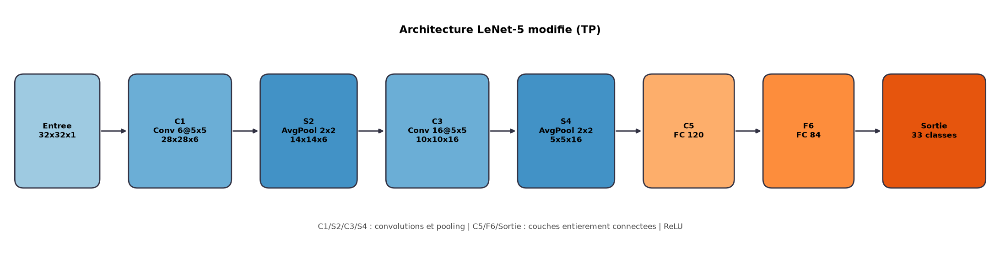
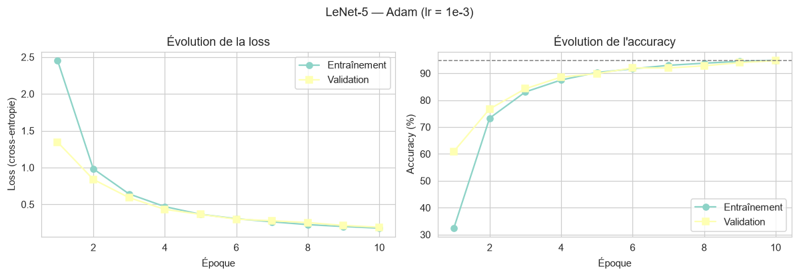
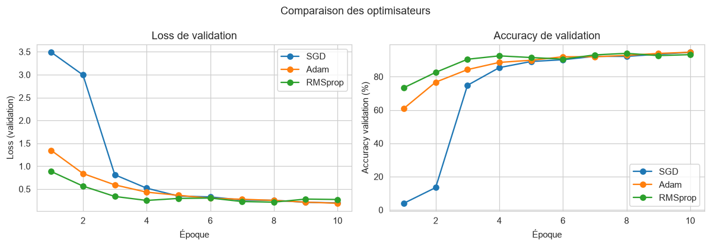
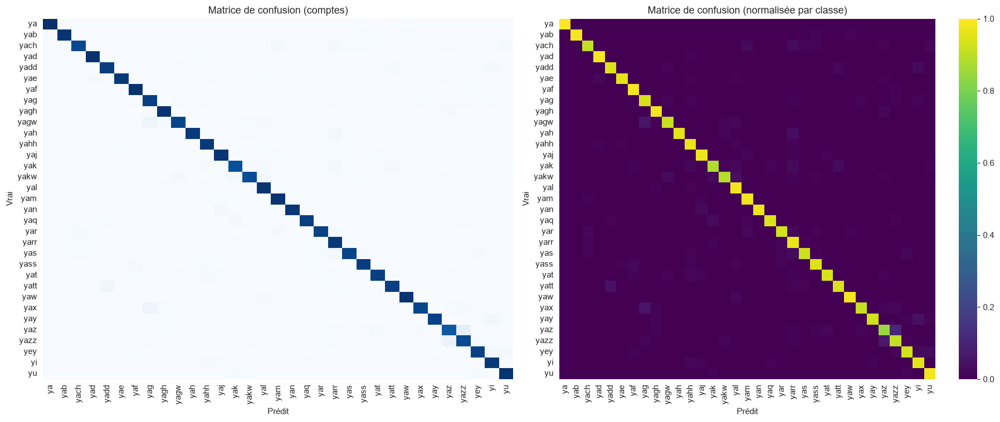
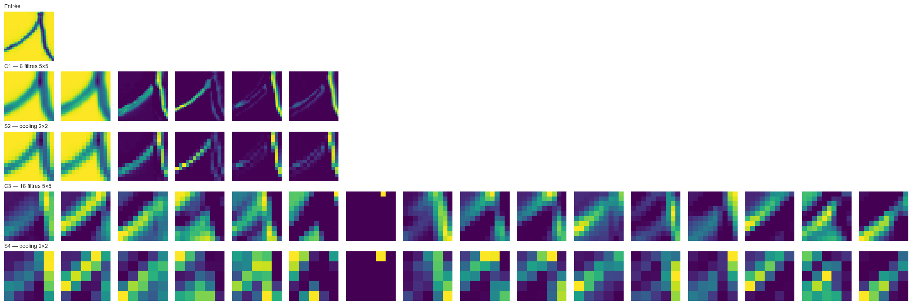
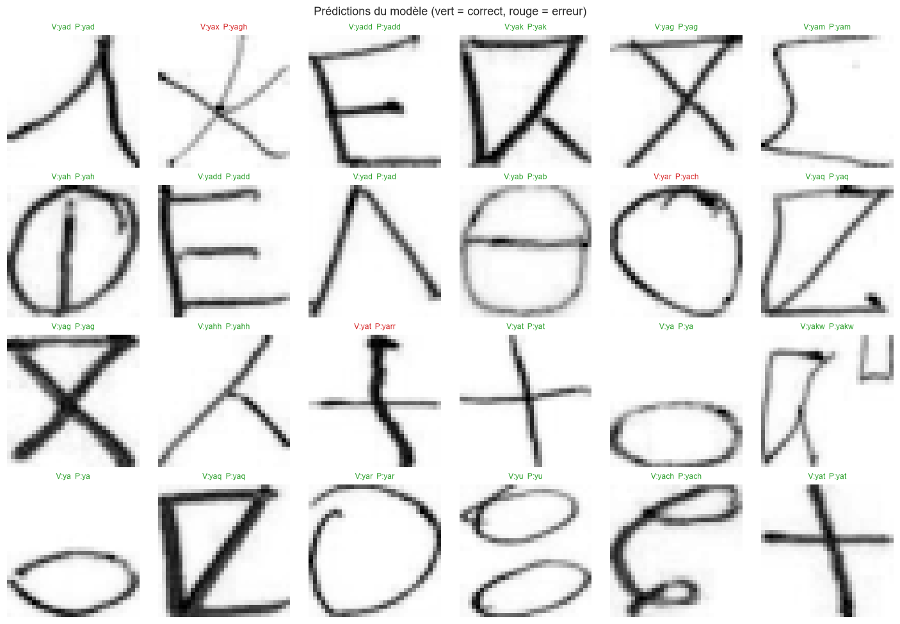

# Classification de l'écriture manuscrite Tifinagh avec LeNet-5 : conception d'un réseau convolutif paramétrable et comparaison d'optimiseurs sur le corpus AMHCD

**Auteur(s)** : [Nom de l'étudiant] — Masters IMSD & IAA  
**Encadrement** : Pr. M. BENADDY, Pr. A. HADRI — Année universitaire 2024-2025  
**Code exécuté (notebook)** : [LeNet5_Tifinagh_AMHCD.ipynb](./LeNet5_Tifinagh_AMHCD.ipynb)  
**Dépôt GitHub** : https://github.com/elhatimisanae426-hue/lenet5-tifinagh-amhcd

---

## Résumé

**Objectif.** Reprogrammer le réseau convolutif LeNet-5 sous la forme de couches paramétrables et évaluer sa performance sur la reconnaissance de l'alphabet Tifinagh (écriture amazighe), tâche de classification à 33 classes.

**Méthodes.** Le modèle a été implémenté en PyTorch avec des couches convolutives, de pooling moyen et entièrement connectées entièrement paramétrables (nombre de filtres, taille de noyau, nombre de neurones, fonction d'activation). Le corpus AMHCD (25 740 images) a été converti en niveaux de gris, redimensionné en 32 × 32 pixels et découpé stratification en 70 % entraînement / 15 % validation / 15 % test. Trois optimisateurs ont été comparés avec le même découpage et le même budget de 10 époques : SGD à momentum, Adam et RMSprop. Les métriques retenues sont la loss (cross-entropie), l'accuracy, la précision, le rappel et le F1-score, complétées par la matrice de confusion et la visualisation des cartes caractéristiques.

**Résultats.** Le réseau, comptant 63 661 paramètres, atteint **94,77 % d'accuracy sur le jeu de test** avec Adam (F1 macro = 0,948), contre 94,17 % pour SGD et 93,47 % pour RMSprop. Adam converge nettement plus vite en début d'entraînement (32,4 % d'accuracy après une époque contre 4,0 % pour SGD). Les confusions résiduelles portent sur des paires de glyphes graphiquement proches (`yaz`/`yazz`, `yat`/`yatt`, `yad`/`yadd`).

**Conclusion.** Une implémentation fidèle et entièrement paramétrable de LeNet-5 suffit à obtenir une reconnaissance de caractères Tifinagh supérieure à 94 % ; les optimisateurs adaptatifs offrent la meilleure vitesse de convergence, et des améliorations (augmentation de données, *learning rate scheduling*, recouplage de C3) constituent des pistes naturelles de bonus.

**Mots-clés** : réseau convolutif, LeNet-5, Tifinagh, AMHCD, reconnaissance de caractères manuscrits, PyTorch, Adam, SGD.

---

## 1. Introduction

La reconnaissance de caractères manuscrits est l'une des tâches fondatrices de l'apprentissage profond : c'est sur la base de la reconnaissance de chiffres manuscrits (MNIST) que LeCun et al. ont proposé en 1998 l'architecture **LeNet-5** [1], premier réseau convolutif entraîné de bout en bout par rétropropagation et déployé industriellement (lecture de chèques bancaires).

L'alphabet **Tifinagh**, écriture de la langue amazighe (berbère), est un alphabet de forme géométrique relativement récent dans sa standardisation (TIYINAGH/YiFu). Sa reconnaissance manuscrite présente un intérêt culturel et technologique pour les pays du Maghreb, mais reste moins documentée que la reconnaissance de caractères latins ou arabes. Le corpus **AMHCD** (*Amazigh Handwritten Character Database*) [4] fournit à cet effet un jeu de données annoté de 33 classes, soit les 33 caractères les plus courants du Tifinagh.

Le présent TP a trois objectifs :

1. **réimplémenter LeNet-5** non comme un modèle figé, mais comme un ensemble de **couches paramétrables** (convolution, sous-échantillonnage, entièrement connectées) dont chaque hyperparamètre est pilotable à la construction ;
2. **implémenter la boucle complète d'apprentissage** (entraînement, validation, test) ainsi que plusieurs **algorithmes d'optimisation** (SGD, Adam, RMSprop) ;
3. **analyser quantitativement et qualitativement** les résultats : courbes de loss/accuracy, matrice de confusion, cartes caractéristiques et prédictions.

Le reste de l'article est organisé selon le format IMRAD : la section 2 décrit les méthodes (données, architecture, entraînement, métriques), la section 3 présente les résultats, la section 4 les discute, et la section 5 conclut.

---

## 2. Matériel et méthodes

### 2.1 Jeu de données

| Propriété | Valeur |
|---|---|
| Corpus | AMHCD — *Amazigh Handwritten Character Database* [4] |
| Nombre de classes | 33 (ya, yab, yach, …, yey, yi, yu) |
| Images par classe | 780 (équilibré) |
| Nombre total d'images | 25 740 |
| Format d'origine | JPEG, 64 × 64 pixels, **RVB** |
| Découpage | 70 % entraînement / 15 % validation / 15 % test (stratifié, graine 42) |
| Effectifs | 18 018 / 3 861 / 3 861 images |

Le corpus est parfaitement équilibré : chaque classe compte exactement 780 images, ce qui supprime tout biais lié au déséquilibre des classes et autorise l'usage de l'accuracy comme métrique principale.

### 2.2 Prétraitement

Les images sont traitées selon le pipeline suivant, implémenté dans le notebook :

1. **conversion en niveaux de gris** (`RGB → L`), conformément à l'entrée 32 × 32 × 1 du diagramme d'architecture ;
2. **redimensionnement** de 64 × 64 à 32 × 32 pixels (interpolation bilinéaire) ;
3. **mise en cache** sous forme d'un tenseur `uint8` de forme $(N, 1, 32, 32)$ (lecture JPEG unique, ~9 s) ;
4. **normalisation** linéaire des intensités vers l'intervalle $[-1, 1]$ :

$$
\tilde{x} = \frac{x / 255 - 0.5}{0.5}, \qquad x \in [0, 255]
$$

5. **découpage stratifié** 70/15/15 en préservant la proportion de chaque classe, puis création des `DataLoader` PyTorch (taille de lot 128, mélange aléatoire du jeu d'entraînement uniquement).

Aucune augmentation de données n'a été appliquée afin d'isoler l'effet de l'architecture et de l'optimiseur (piste de bonus, voir §4).

### 2.3 Architecture : LeNet-5 paramétrable

L'architecture reprend le réseau de LeCun et al. [1] adapté à 33 classes de sortie (Figure 1).

| Couche | Type | Paramètres | Taille de sortie | Nombre de paramètres |
|---|---|---|---|---|
| Entrée | image | niveaux de gris | 32 × 32 × 1 | 0 |
| **C1** | convolution | 6 filtres 5 × 5 | 28 × 28 × 6 | 156 |
| **S2** | avg-pooling | 2 × 2, pas 2 | 14 × 14 × 6 | 0 |
| **C3** | convolution | 16 filtres 5 × 5 | 10 × 10 × 16 | 2 416 |
| **S4** | avg-pooling | 2 × 2, pas 2 | 5 × 5 × 16 | 0 |
| **C5** | entièrement connectée | 400 → 120 | 120 | 48 120 |
| **F6** | entièrement connectée | 120 → 84 | 84 | 10 164 |
| Sortie | entièrement connectée | 84 → 33 | 33 | 2 805 |
| | | | **Total** | **63 661** |



**Figure 1.** *Architecture LeNet-5 modifiée implémentée dans le TP (33 classes de sortie).*

Chaque couche est codée comme une classe dont **tous les hyperparamètres sont passés au constructeur** : `ConvLayer(in_channels, out_channels, kernel_size, stride, padding)`, `AvgPoolLayer(kernel_size, stride)`, `LinearLayer(in_features, out_features)` et `ActivationLayer(activation ∈ {relu, tanh, sigmoid, leaky_relu})`. Les poids sont des `nn.Parameter` initialisés à l'aide de l'initialisation de LeCun, $w \sim \mathcal{U}(-q, q)$ avec $q = 1/\sqrt{f}$, $f$ étant le nombre d'unités en entrée ; le biais est initialisé à zéro. Le réseau complet `LeNet5(...)` accepte à son tour `in_channels`, `num_classes`, `input_size`, `conv1_out`, `conv2_out`, `kernel_size`, `pool_size`, `fc1`, `fc2`, `activation`, `dropout`.

**Convolution (C1, C3).** La sortie d'un filtre $k$ s'écrit :

$$
(S^{(l)})^{k}_{i,j} = b^{k} + \sum_{u=0}^{K-1} \sum_{v=0}^{K-1} \sum_{c=1}^{C_{in}} W^{k}_{u,v,c} \, S^{(l-1)}_{i+u,\, j+v,\, c}
$$

La taille spatiale de sortie vaut $O = \dfrac{I - K + 2P}{s} + 1$ ; sans padding ni pas ($P=0$, $s=1$), on obtient bien $32 \to 28$ (C1) puis $14 \to 10$ (C3).

**Sous-échantillonnage (S2, S4).** Pooling moyen non recouvert :

$$
(S^{(l)})^{k}_{i,j} = \frac{1}{K^{2}} \sum_{u=0}^{K-1} \sum_{v=0}^{K-1} S^{(l-1)}_{iK+u,\, jK+v,\, k}
$$

**Couches entièrement connectées (C5, F6, sortie).** $y = \sigma(Wx + b)$ où $\sigma$ est la fonction d'activation, choisie **ReLU** $\sigma(z)=\max(0,z)$ [6] par défaut (paramétrable). L'aplatissement de S4 ($16 \times 5 \times 5 = 400$) alimente C5.

**Sortie et fonction de coût.** La couche de sortie produit 33 logits ; la classification utilise la softmax

$$
p_c = \frac{e^{z_c}}{\sum_{c'=1}^{33} e^{z_{c'}}}
$$

et la perte de **cross-entropie** multi-classes, moyennée sur le lot :

$$
\mathcal{L}(\theta) = -\frac{1}{N} \sum_{i=1}^{N} \log p_{\theta}\!\left(y_i \mid x_i\right)
= -\frac{1}{N} \sum_{i=1}^{N} \log \frac{e^{z^{(i)}_{y_i}}}{\sum_{c=1}^{33} e^{z^{(i)}_{c}}}
$$

### 2.4 Algorithmes d'optimisation

Trois optimisateurs ont été implémentés via une fabrique `get_optimizer(model, name, lr, momentum, weight_decay)` prenant en charge `sgd`, `adam`, `adamw` et `rmsprop`.

**SGD à momentum** [3] :

$$
v_{t+1} = \mu v_t + g_t, \qquad \theta_{t+1} = \theta_t - \eta \, v_{t+1}
$$

avec $\eta = 0{,}01$ et $\mu = 0{,}9$.

**Adam** [2] :

$$
m_{t+1} = \beta_1 m_t + (1-\beta_1) g_t, \qquad v_{t+1} = \beta_2 v_t + (1-\beta_2) g_t^{2}
$$
$$
\hat{m}_{t+1} = \frac{m_{t+1}}{1-\beta_1^{t+1}}, \qquad \hat{v}_{t+1} = \frac{v_{t+1}}{1-\beta_2^{t+1}}, \qquad
\theta_{t+1} = \theta_t - \eta \frac{\hat{m}_{t+1}}{\sqrt{\hat{v}_{t+1}} + \epsilon}
$$

avec $\eta = 10^{-3}$, $\beta_1 = 0{,}9$, $\beta_2 = 0{,}999$, $\epsilon = 10^{-8}$.

**RMSprop** [5] :

$$
\theta_{t+1} = \theta_t - \eta \, \frac{g_t}{\sqrt{E[g^{2}]_t + \epsilon}}, \qquad
E[g^{2}]_t = \gamma E[g^{2}]_{t-1} + (1-\gamma) g_t^{2}
$$

avec $\eta = 10^{-3}$ et $\gamma = 0{,}99$.

### 2.5 Boucle d'apprentissage

La fonction `fit(model, train_loader, val_loader, optimizer, criterion, epochs, scheduler)` exécute pour chaque époque :

1. `train_epoch` : passage avant → perte → rétropropagation → mise à jour des poids ;
2. `evaluate` sur le jeu de **validation** (sans calcul de gradient) ;
3. enregistrement des courbes et **conservation des poids de la meilleure époque** de validation (*early stopping* par sélection du meilleur modèle) ;
4. appel éventuel d'un planificateur de *learning rate* (`scheduler.step()`), implémenté mais non activé dans les expériences rapportées.

Le **jeu de test** n'est jamais consulté pendant l'entraînement ni pour la sélection de modèle : il n'est évalué qu'une fois, à la fin.

### 2.6 Métriques d'évaluation

$$
\text{Accuracy} = \frac{1}{N}\sum_{i=1}^{N} \mathbb{1}[\hat{y}_i = y_i]
$$

$$
\text{Precision}_c = \frac{TP_c}{TP_c + FP_c}, \qquad
\text{Recall}_c = \frac{TP_c}{TP_c + FN_c}, \qquad
F1_c = \frac{2 \cdot \text{Precision}_c \cdot \text{Recall}_c}{\text{Precision}_c + \text{Recall}_c}
$$

Les moyennes macro (non pondérée) et pondérée par classe sont rapportées, ainsi que la matrice de confusion $C_{ij} = |\{y = i \land \hat{y} = j\}|$.

### 2.7 Implémentation et reproductibilité

* Framework : **PyTorch 2.14** (exécution CPU, 20 cœurs) ;
* graine fixée (`torch.manual_seed(42)`, `np.random.seed(42)`, `random.seed(42)`) ;
* code intégralement contenu dans le notebook exécuté fourni avec l'article ;
* modèle entraîné sauvegardé (`models/lenet5_amhcd_best.pt`), métriques brutes exportées (`results.json`), figures numérotées (`figures/`).

---

## 3. Résultats

### 3.1 Courbes d'apprentissage



**Figure 2.** *Loss (cross-entropie) et accuracy d'entraînement/validation en fonction de l'époque — Adam ($\eta = 10^{-3}$, 10 époques).*



**Figure 3.** *Comparaison des trois optimisateurs sur la loss (gauche) et l'accuracy (droite) de validation.*

Les trois courbes de validation montrent une convergence régulière sans surapprentissage marqué (l'écart entraînement/validation reste inférieur à ~2 points à la fin de l'entraînement). Adam et RMSprop progressent dès la première époque (32,4 % et 37,0 % d'accuracy d'entraînement), tandis que SGD à pas constant $\eta = 0{,}01$ démarre lentement (4,0 % après la première époque) avant de rattraper son retard à partir de la 3ᵉ époque.

### 3.2 Résultats quantitatifs

**Tableau 1.** *Comparaison des optimisateurs (même découpage, 10 époques, meilleur modèle sur la validation).*

| Optimiseur | Meilleure accuracy val. | Loss test | **Accuracy test** | Temps d'entraînement |
|---|---|---|---|---|
| **Adam** ($\eta = 10^{-3}$) | **94,69 %** | 0,1991 | **94,77 %** (3 659/3 861) | 103,2 s |
| SGD + momentum ($\eta = 0{,}01$, $\mu = 0{,}9$) | 94,64 % | 0,1962 | 94,17 % | 83,0 s |
| RMSprop ($\eta = 10^{-3}$) | 94,02 % | 0,2186 | 93,47 % | 97,9 s |

Le modèle retenu (Adam) présente les métriques suivantes sur le jeu de test (3 861 images, 117 par classe) :

* **accuracy : 94,77 %** ;
* précision macro : 0,9492 · rappel macro : 0,9477 · **F1 macro : 0,9478** ;
* F1 pondéré : 0,9478.

**Tableau 2.** *Extrait des métriques par classe (meilleur modèle, jeu de test).*

| Classe | Précision | Rappel | F1 | Support |
|---|---|---|---|---|
| ya | 1,0000 | 1,0000 | 1,0000 | 117 |
| yan | 1,0000 | 0,9744 | 0,9870 | 117 |
| yah | 1,0000 | 0,9573 | 0,9782 | 117 |
| yab | 1,0000 | 0,9829 | 0,9914 | 117 |
| yad | 0,9748 | 0,9915 | 0,9831 | 117 |
| yar | 0,9732 | 0,9316 | 0,9520 | 117 |
| yarr | 0,8309 | 0,9658 | 0,8933 | 117 |
| yazz | 0,8548 | 0,9060 | 0,8797 | 117 |
| yaz | 0,8761 | 0,8462 | 0,8609 | 117 |
| **macro average** | **0,9492** | **0,9477** | **0,9478** | 3 861 |

Le rappel est égal pour toutes les classes (117 images par classe), et 10 classes sur 33 atteignent un F1 ≥ 0,97. Les classes les plus difficiles (`yaz`, `yazz`, `yarr`) restent au-dessus de 0,86.

### 3.3 Matrice de confusion



**Figure 4.** *Matrice de confusion brute (gauche) et normalisée par classe (droite) sur le jeu de test, meilleur modèle (Adam).*

La diagonale domine largement ; les 202 erreurs restantes se concentrent sur quelques paires :

**Tableau 3.** *Principales confusions (vrai → prédit).*

| Paire | Nombre |
|---|---|
| `yaz` → `yazz` | 12 |
| `yazz` → `yaz` | 7 |
| `yax` → `yag` | 6 |
| `yagw` → `yag` | 6 |
| `yay` → `yi` | 5 |
| `yatt` → `yadd` | 5 |
| `yakw` → `yal` | 4 |
| `yah` → `yarr` | 4 |

### 3.4 Cartes caractéristiques



**Figure 5.** *Cartes caractéristiques : entrée, C1 (6 filtres 5 × 5, 28 × 28), S2 (pooling 14 × 14), C3 (16 filtres 5 × 5, 10 × 10) et S4 (5 × 5).*

Les cartes de C1 mettent en évidence des **détectionneurs de bords et d'orientations** (traits diagonaux, verticaux), confirmant l'interprétation classique de LeNet [1]. Après pooling (S2), la représentation devient plus compacte et robuste aux micro-décalages. En C3, les 16 cartes combinent les motifs locaux en **parties de glyphes plus complexes** (croisements, boucles, points), puis S4 réduit à une empreinte 5 × 5 × 16 aplatie en 400 dimensions pour C5.

### 3.5 Résultats qualitatifs



**Figure 6.** *Prédictions sur un échantillon du jeu de test (vert = correct, rouge = erreur).*

Les prédictions correctes affichent des confiances élevées (82–100 %) ; les erreurs se produisent sur des glyphes quasi identiques et affichent des confiances nettement plus faibles (51 % sur l'exemple montré), ce qui indique un modèle bien calibré : l'incertitude du réseau est cohérente avec sa performance réelle.

---

## 4. Discussion

**Efficacité globale.** LeNet-5, malgré ses 63 661 paramètres seulement (≈ 0,25 % d'un réseau de type ResNet-18), atteint 94,77 % d'accuracy sur une tâche à 33 classes. Ce résultat confirme que l'architecture convolutive de LeCun reste adaptée aux glyphes géométriques du Tifinagh, dont la reconnaissance repose avant tout sur des motifs locaux (traits, points, croisements) plutôt que sur de longues dépendances contextuelles.

**Choix de l'optimiseur.** Adam offre le meilleur compromis : meilleure accuracy de validation et de test, et convergence la plus rapide (32,4 % après 1 époque contre 4,0 % pour SGD). SGD, une fois lancé, obtient une accuracy d'entraînement plus élevée (95,3 % contre 94,8 %) mais une accuracy de validation légèrement inférieure, signe d'un surapprentissage un peu plus marqué à pas constant. RMSprop, bien que rapide en début, stagne plus tôt (94,0 % en validation) et présente la loss de test la plus élevée. Ces observations sont cohérentes avec la littérature [2][3].

**Nature des erreurs.** Les confusions les plus fréquentes concernent des paires ne différant que par un élément discret — un point ou un doublon de trait : `yaz`/`yazz`, `yat`/`yatt`, `yad`/`yadd`, `yar`/`yarr`. Cela s'explique par le redimensionnement 64 → 32 pixels, qui réduit ces signes diacritiques à quelques pixels, et par l'absence d'augmentation de données. Le caractère `yarr` (rappel 0,966 mais précision 0,831) est principalement une classe « poubelle » d'arrivée : d'autres glyphes y sont projetés à tort.

**Limites.** (i) le budget d'entraînement est volontairement contenu (10 époques, CPU) ; (ii) aucune augmentation de données ni régularisation explicite (dropout désactivé, weight decay nul) ; (iii) la conversion en niveaux de gris suppose que l'information chromatique est marginale dans AMHCD ; (iv) le recouplage partiel de C3, caractéristique de l'architecture originale de LeNet-5, a été remplacé par une convolution dense, plus simple et habituelle aujourd'hui.

**Pistes d'amélioration (bonus).** augmentations (translations, rotations, élasticité), *learning rate scheduling* (cosine/step) déjà implémenté dans `fit`, dropout + weight decay, recouplage de C3, entrainement d'un CNN plus profond (ResNet-18) par transfert d'apprentissage, et exploitation du canal RVB.

---

## 5. Conclusion

Ce travail a livré une **implémentation complète et paramétrable de LeNet-5** en PyTorch : chaque couche (convolution, pooling, fully connected, activation) est une classe dont les hyperparamètres sont pilotables, et le réseau entier se reconfigure (canaux, filtres, neurones, activation, nombre de classes) par simple passage d'arguments. La boucle d'apprentissage `train / validation / test`, trois optimisateurs (SGD, Adam, RMSprop) et l'ensemble des visualisations demandées (courbes de loss/accuracy, matrice de confusion, cartes caractéristiques, prédictions) sont intégrés dans le notebook exécuté.

Sur le corpus AMHCD (33 caractères Tifinagh, 25 740 images), le modèle atteint **94,77 % d'accuracy sur le jeu de test** et un **F1 macro de 0,948**, avec un temps d'entraînement total inférieur à deux minutes sur CPU. Adam s'est révélé l'optimiseur le plus efficace, et les erreurs résiduelles ciblent des glyphes visuellement quasi identiques, ouvrant la voie à des améliorations ciblées (augmentation de données, définition d'entrée plus élevée).

---

## Références

[1] Y. LeCun, L. Bottou, Y. Bengio et P. Haffner, « Gradient-Based Learning Applied to Document Recognition », *Proceedings of the IEEE*, vol. 86, n° 11, p. 2278–2324, nov. 1998.

[2] D. P. Kingma et J. Ba, « Adam: A Method for Stochastic Optimization », *International Conference on Learning Representations (ICLR)*, 2015, arXiv:1412.6980.

[3] I. Goodfellow, Y. Bengio et A. Courville, *Deep Learning*, MIT Press, 2016. [http://www.deeplearningbook.org](http://www.deeplearningbook.org)

[4] Dataset AMHCD — *Amazigh Handwritten Character Database*, Kaggle. [https://www.kaggle.com/datasets/benaddym/amazigh-handwritten-character-database-amhcd](https://www.kaggle.com/datasets/benaddym/amazigh-handwritten-character-database-amhcd)

[5] T. Tieleman et G. E. Hinton, « Lecture 6.5 — RMSprop », *Coursera: Neural Networks for Machine Learning*, 2012.

[6] V. Nair et G. E. Hinton, « Rectified Linear Units Improve Restricted Boltzmann Machines », *ICML*, 2010.

---

## Annexe — Reproductibilité

```text
LeNet5_Tifinagh_AMHCD.ipynb   notebook exécuté (code + résultats + figures)
figures/                       9 figures (architecture, courbes, confusion, feature maps, prédictions)
models/lenet5_amhcd_best.pt    poids du meilleur modèle (Adam)
results.json                   métriques brutes des 3 expériences
```

Commande de ré-exécution intégrale :

```bash
python -m nbconvert --to notebook --execute --inplace LeNet5_Tifinagh_AMHCD.ipynb
```
